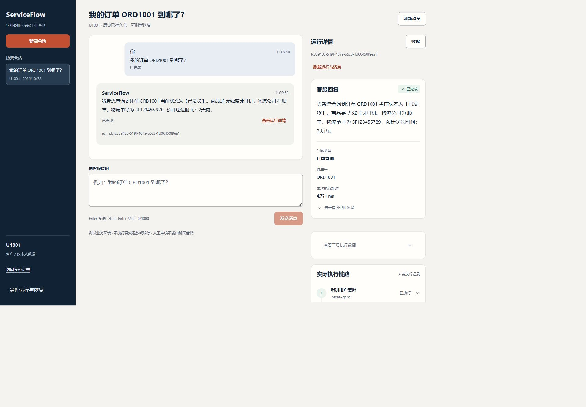
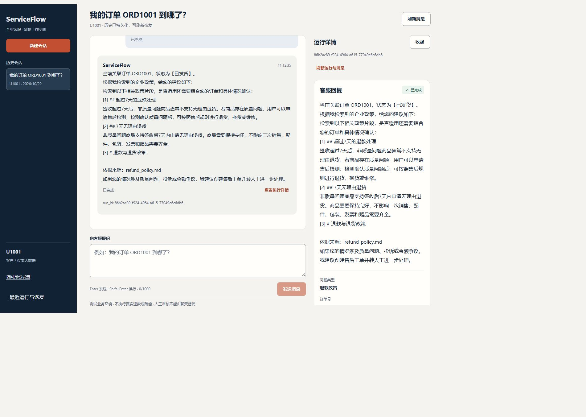
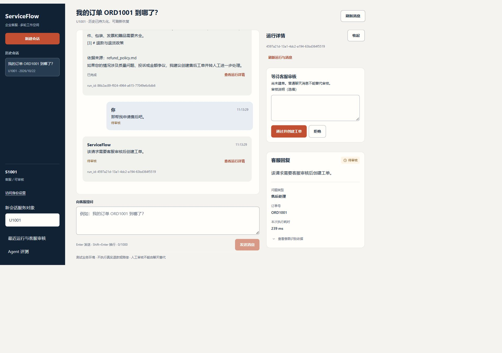
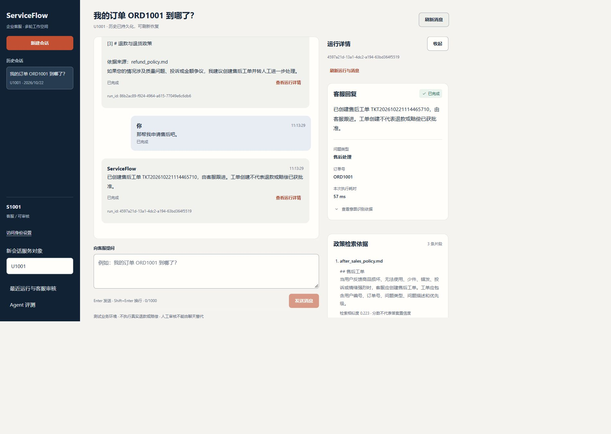
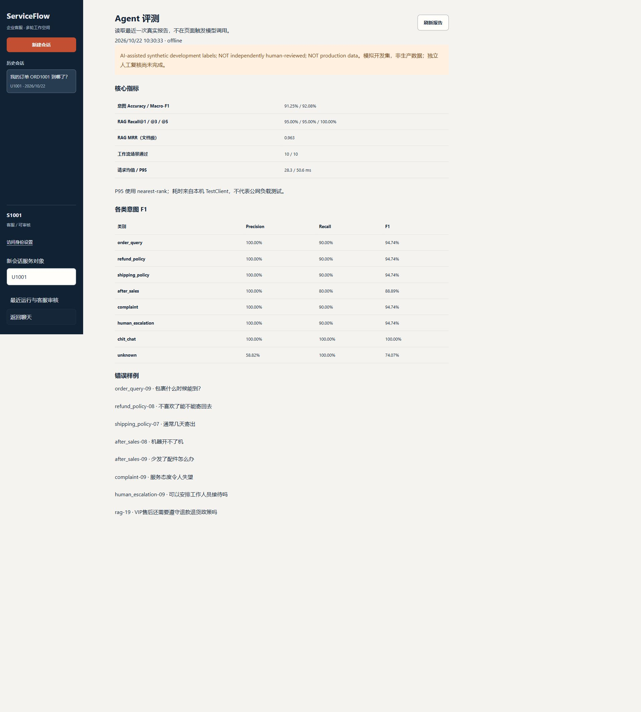

# ServiceFlow · 企业客服多 Agent 系统

[](https://github.com/YangCurry11/enterprise-support-agent/actions/workflows/ci.yml)
[运行指南](docs/PHASE1_UPGRADE.md) · [多轮架构](docs/MULTI_TURN_ARCHITECTURE.md) · [评测说明](docs/EVALUATION_GUIDE.md) · [千问第二阶段](docs/PHASE2_QWEN_VALIDATION.md) · [第二阶段收尾记录](docs/PHASE2_RELEASE_20261023.md)

**v0.4 / Phase 3A 真实Embedding检索核验**：[混合RAG精讲](docs/PHASE3A_HYBRID_RAG.md) · [验证记录](docs/PHASE3A_VERIFICATION.md) · [2026-10-26收尾报告](docs/PHASE3A_REAL_ACCEPTANCE_20261026.md)。用户已运行text-embedding-v4/1024维；本轮仅离线核验既有真实报告，新增模型请求0。36题三模式缓存排名可复现；独立人工证据复核与自动安全拒答尚未验收。默认仍为TF-IDF，不自动启用付费调用。

**v0.5 / Phase 3B 本地离线工程版本**：[只读工具实现](docs/PHASE3B_SAFE_TOOL_CALLING.md) · [本轮验证记录](docs/PHASE3B_VERIFICATION.md#10-最终代码审查与本地提交验收2026-10-26) · [运行与手动验收](docs/PHASE3B_DEMO.md)。可选模型规划仅开放query_order/search_policy，服务端严格校验与客户权限隔离，原人工审核和幂等建单保留。默认关闭；最终审查363项后端、27项前端及生产构建通过，固定36场景/新三轮均离线完成，真实Tool Calling效果待另行授权。开发分支独立于main，尚未推送，不表示main已包含v0.5。

一个基于 **Vue 3 + TypeScript、FastAPI、LangGraph 与 SQLite** 的客服工作流项目：在同一会话中查询订单、追问政策、申请售后，并将需要业务写入的请求交给人工审核。

项目的重点不只是“生成一句回复”，而是把**会话记忆、工具权限、人工审核、幂等建单和故障恢复**接到同一条可追踪的处理链路。

> 当前使用模拟订单、用户与政策数据，适合本机学习和受控单实例试点。截图来自当前版本的真实前后端操作，不是设计稿；展示时关闭模型 API，使用规则分类与模板回复。系统不会执行真实退款或赔偿。

## 导航

<details>
<summary>展开阅读目录</summary>

- [页面展示](#页面展示)
- [项目亮点](#项目亮点)
- [三轮对话实操](#三轮对话实操)
- [系统架构](#系统架构)
- [快速开始](#快速开始)
- [评测与测试](#评测与测试)
- [项目结构](#项目结构)
- [接口与配置](#接口与配置)
- [部署边界](#部署边界)
- [学习文档](#学习文档)

</details>

## 页面展示

### 连续聊天与运行详情

左侧管理历史会话，中间连续提问，右侧查看单次运行的状态、工具数据、政策依据和 Agent 执行轨迹。每条助手消息都关联真实的 run_id，详情面板可以收起。



*客户 U1001 查询自己的 ORD1001。页面返回模拟物流信息，并保留可追踪的运行记录。点击图片可查看原图。*

### 政策问答与来源溯源

追问“那它可以退款吗？”时，系统关联本会话已确认的订单，重新校验访问权限，再检索退款政策。回复展示来源文件；运行详情可查看片段与检索分数。



*政策检索使用当前项目的中文字符 n-gram TF-IDF；相似度分数不代表答案置信度，也不是“自动批准退款”。*

## 项目亮点

| 能力 | 当前实现 | 为什么需要 |
|---|---|---|
| 多轮会话 | 独立 conversation_id；SQLite 保存消息、会话归属及关联运行 | 刷新后能恢复聊天，不依赖前端临时数组 |
| 有界上下文 | 最近消息窗口、字符预算、服务端确认订单 | 理解“那它”这类业务追问，避免无限拼接历史 |
| 受控多 Agent | Intent / Order / Policy / Ticket / Response 分工，LangGraph 显式路由 | 每个业务动作可解释、可测试，不让模型无限自主执行 |
| 用户隔离 | Bearer Token → Principal → 会话 owner 与 ScopedTools 归属检查 | 历史消息和模型输出不能成为访问别人的订单的凭据 |
| 人工审核 | interrupt 暂停，客服专属接口通过 Command(resume=...) 恢复 | 先审核再建单，普通聊天不能伪造 approved |
| 幂等与恢复 | request_id 去重、固定消息 ID、工单唯一键、SQLite Checkpointer | 网络丢响应后重试，避免重复消息与重复工单 |
| 政策 RAG | 默认TF-IDF；可选独立Embedding、NumPy Dense、RRF混合检索；稳定片段ID与来源 | 不把融合分当置信度；无索引或向量错误时明确回退，不自动付费重建 |
| 模型回退 | 可配置兼容 API；分类回退规则，回复失败保留模板 | 模型不可用时仍能运行确定性业务，轨迹记录实际模式 |
| 签收事实边界 | 本轮授权工具生成 received / not_received / unknown 三态，区分 null 与0天 | 已发货或缺签收记录不能被模型解释成“尚未签收”；政策条件不等于订单事实 |
| 可选只读Tool Calling | 默认false；模型只提议订单查询/政策检索；整批schema、调用ID、上下文与预算校验 | 身份与审批由服务端控制；失败回原模板，模型无法直接建单或执行SQL |
| 效果评测 | 意图同批规则/模型对比、政策检索、回复/权限/审核、离线故障与三轮工具；JSON / CSV / Markdown / 待人工表 | 将功能测试、模型效果与人工质量验收分开；显式组件、含重试的调用预算 |

这里的 Multi-Agent 是**显式分工、受约束的业务工作流**。Phase 3A已增加可选Embedding与混合检索，并完成小型模拟开发集的真实向量缓存核验；Phase 3B增加有界只读工具规划，仍由原LangGraph控制写操作和人工审核。没有引入向量数据库或模型微调，小型开发集结果不作为生产效果证明。

## 三轮对话实操

建议在同一个新会话中依次输入以下问题：

| 轮次 | 输入 | 预期行为 |
|---|---|---|
| 第一轮 | 我的订单 ORD1001 到哪了？ | 查询本人的订单和物流，得到已完成的运行 |
| 第二轮 | 那它可以退款吗？ | 关联 ORD1001，复核归属并检索当前退款政策 |
| 第三轮 | 那帮我申请售后吧。 | 关联同一订单，暂停在 awaiting_review，尚未创建工单 |

### 售后申请先等待审核

客户提交第三轮请求后，系统保存检查点。有客服权限的人在“访问身份设置”验证身份，选择该历史会话，再打开最后一条消息的“查看运行详情”。



*图中使用的是公开本机客服身份 S1001，能看到“通过并创建工单”和“拒绝”；客户身份看不到这些审批按钮。*

### 审核通过后继续原运行

客服批准后，LangGraph 从同一 run 的检查点继续执行 TicketAgent。助手消息更新为工单结果；拒绝则不会建单。



*审核前后 run_id 保持不变。工单创建仅表示已进入售后跟进，不代表退款或赔偿已获批准。*

### 还可以检查这些边界

- **缺少订单号：**新会话输入“帮我查一下订单”，再补充 ORD1001，应恢复原 awaiting_input 的 run。
- **越权订单：**客户 U1001 查询 ORD1002，应拒绝透露其他客户的商品和物流。
- **会话隔离：**新建另一会话，“那它”不能自动继承上一会话的订单。
- **安全重试：**消息失败后使用“安全重试原消息”，沿用原 request_id；不要换新键反复提交。
- **历史恢复：**刷新后重新验证同一身份、选择原会话，可读取历史与审核后的最新结果。
- **旧功能入口：**“最近运行与恢复 / 最近运行与客服审核”保留原工作台与审核队列。

Enter 发送、Shift+Enter 换行；输入法组词时 Enter 不发送。当前为同步 HTTP 请求，并非流式 SSE 聊天。

## 系统架构

~~~mermaid
flowchart TD
    UI["Vue 3 + TypeScript 客服工作台"] --> API["FastAPI / Bearer 身份校验"]
    API --> CHAT["ConversationService 会话、消息与请求去重"]
    CHAT --> CONTEXT["有界历史 + 已确认订单线索"]
    CONTEXT --> RUN["WorkflowService / LangGraph"]
    CHAT -. "会话与消息" .-> REGISTRY[("workflow_runs.db")]
    RUN -. "运行登记" .-> REGISTRY
    RUN -. "run_id = thread_id" .-> CHECKPOINT[("workflow_checkpoints.db")]
    RUN --> AGENTS["Intent / Order / Policy / Response"]
    AGENTS --> TOOLS["ScopedTools / 客户归属校验"]
    TOOLS --> BIZ[("business.db / 模拟订单与工单")]
    TOOLS --> RAG["PolicyKnowledgeBase / 默认TF-IDF、可选Dense或RRF Hybrid"]
    AGENTS --> FACTS["OrderFacts / 本轮已知事实、未知字段、政策条件"]
    FACTS --> MODEL["Qwen 辅助分类与回复 / 有界调用"]
    MODEL --> SAFETY["最小事实检查 / 失败保留模板"]
    RUN --> REVIEW["售后、投诉等需要人工审核的请求"]
    REVIEW --> PAUSE["interrupt 暂停 / 客服审批"]
    PAUSE --> RESUME["Command resume / 同一 run 继续"]
    RESUME --> TICKET["TicketAgent / 幂等建单"]
    TICKET --> TOOLS
~~~

### 四种 ID 各管一件事

| 标识 | 职责 | 什么时候保持不变 |
|---|---|---|
| conversation_id | 归组完整聊天会话 | 同一会话的多轮请求 |
| run_id | 标识一次业务执行，同时作为 Checkpointer 的 thread_id | 澄清、人工审核与故障恢复 |
| request_id | 标识一次提交的业务幂等键 | 同一次提交失败重试 |
| message_id | 标识一条已持久化消息 | 同一次请求重试不新增重复消息 |

一个会话可以有多个 run。已完成后的新业务请求创建新 run；补充订单号则优先恢复原来待补充的 run。不能直接用 conversation_id 替换 thread_id，否则可能混淆待审核和已完成流程。

消息登记、图检查点和业务工单分别持久化，依靠幂等与状态对齐协作；**不宣称跨数据库的分布式 exactly-once**。详细设计见[多轮架构说明](docs/MULTI_TURN_ARCHITECTURE.md)。

## 快速开始

### 环境要求

- Python 3.12，后端沿用项目的 .venv。
- Node.js 24、pnpm 11.19.0（与 packageManager 和 CI 对齐）。
- Windows / PowerShell 为主要本地开发环境；SQLite 不需要另启数据库服务。
- 可选的大模型 API：未配置时可以使用规则分类和模板回复。

已有 .venv、依赖和配置时，直接运行启动命令，不必重新创建环境。下列克隆与安装只需首次执行。

### 1. 获取代码并安装后端依赖

~~~powershell
git clone https://github.com/YangCurry11/enterprise-support-agent.git
cd enterprise-support-agent

# 已有 .venv 时跳过创建
python -m venv .venv
.\.venv\Scripts\python.exe -m pip install -r requirements.txt

# 不覆盖已有的私有配置
if (-not (Test-Path .env)) { Copy-Item .env.example .env }
~~~

### 2. 启动后端

在项目根目录的终端运行：

~~~powershell
.\.venv\Scripts\python.exe -m uvicorn support_agent.app:app --reload --host 127.0.0.1 --port 8000
~~~

后端文档：<http://127.0.0.1:8000/docs>。保持该终端运行。

### 3. 启动前端

新开第二个终端：

~~~powershell
cd frontend

# 仅尚未安装 pnpm 时执行
npm.cmd install -g pnpm@11.19.0
pnpm.cmd install --frozen-lockfile
pnpm.cmd dev
~~~

打开 <http://127.0.0.1:5173>。使用 .cmd 可避免 PowerShell 对 npm.ps1 / pnpm.ps1 的执行策略限制。

### 4. 本机开发身份

| 公开开发凭证 | 身份 | 可做的事 |
|---|---|---|
| dev-customer-u1001 | U1001 / customer | 本人订单查询、政策问答、售后申请、补充订单号 |
| dev-support-reviewer | S1001 / support | 审核通过或拒绝、查看运行记录和评测报告 |

这些凭证仅在 development 且未自定义 SUPPORT_AUTH_TOKENS 时使用。如果已有 .env 私有配置，以自己的配置为准；不要为了截图覆盖真实密钥。客服新建会话时需要填写合法服务对象，例如 U1001。

## 评测与测试

### Phase 3B 只读工具离线验收

```powershell
.\.venv\Scripts\python.exe -m evaluation.evaluate_tool_calling --mode offline --output evaluation/reports-tool-calling-my-run
.\.venv\Scripts\python.exe -m evaluation.verify_tool_calling --mode offline --output evaluation/reports-tool-e2e-my-run
# 仅读取配置和合成数据指纹，不创建客户端、不联网
.\.venv\Scripts\python.exe -m evaluation.verify_tool_calling --check-config
```

最终审查完整Pytest **363 passed**、前端 **27 passed**，pip check和生产构建通过。固定36场景全部符合工程预期，但其中有故意错误的脚本模型输出：原始工具名称集合选择29/36、已检查参数通过23/32、实际模型触发读取成功17/20、安全样例拒绝11/11、回退24/36。模拟模型尝试50次，真实供应商调用0；这些不是千问准确率。新三轮离线通过1/1，4次脚本请求，第三轮停在原审核节点。详细分母、错误记录和边界见[本轮验证](docs/PHASE3B_VERIFICATION.md#10-最终代码审查与本地提交验收2026-10-26)。

真实Tool Calling验收必须另外明确授权，专用命令要求allow-remote和全局请求预算，并只允许指纹固定的合成数据；本轮没有执行，不自动上传已有数据。旧评测语义保留，下面3A/第二阶段数字均带历史范围。

### Phase 3A 三模式对照

```powershell
# 全离线；默认Mock词法哈希向量，不能当真实语义模型效果
.\.venv\Scripts\python.exe -m evaluation.compare_rag --mode offline
# 原离线评测语义不变，强制使用历史TF-IDF基线
.\.venv\Scripts\python.exe -m evaluation.run_evaluation --mode offline
```

2026-10-26重新执行：**后端299 passed、前端23 passed**，生产构建与pip check通过，原离线工作流10/10、三轮1/1。真实Embedding为用户此前单独执行的6次请求、供应商945输入Token、usage完整；公开价格估算¥0.0004725，不是实际账单。本轮新增模型请求0，不修改gold或删除错例。

| 集合 / 指标 | TF-IDF | Real Dense | Real Hybrid |
|---|---:|---:|---:|
| Historical20 证据Hit@3 | 19/20 | 20/20 | 20/20 |
| Hard16的13正例 证据Hit@3 | 8/13 | 13/13 | 11/13 |
| Hard16的13正例 文档MRR | 0.8077 | 0.9231 | 0.8654 |

**Dense在本次困难集上优于Hybrid**，不能宣传RRF必然提升；历史Mock结果单独保留。两次真实缓存对照均新增请求0，108组问题×模式、540条候选的chunk_id、排名、得分一致。三种模式对3个无依据问题均返回候选，这不是政策支持证明，自动安全拒答尚未验收；全部36题的独立人工证据复核仍待完成。小型模拟开发集的命中结果不等于真实客服答案准确率、生产SLA或ROI。

缓存、远程文本最小化、调用预算、全部实际指标与手动live命令见[3A手册](docs/PHASE3A_HYBRID_RAG.md)和[验证报告](docs/PHASE3A_VERIFICATION.md)。每次对照默认生成唯一忽略目录，不覆盖历史报告。下面页面截图及第二阶段记录是既有历史，不冒称新的Dense线上结果。

### 评测页面

客服身份可读取最近一次实际评测报告，查看 Accuracy、各类 F1、Recall@K、MRR、工作流通过数和错误样例。没有报告时显示空状态，不展示虚构成绩。



*页面只读取报告，不触发模型调用。截图中的耗时来自本机 TestClient，不是公网压测结果。*

### 运行评测

在项目根目录运行：

~~~powershell
# 默认 offline：不发起真实模型请求
.\.venv\Scripts\python.exe -m evaluation.run_evaluation
~~~

默认生成 evaluation/reports/latest.json、details.csv、summary.md、manual_review.csv；这些生成文件被 Git 忽略。第二阶段新增6个回复/业务安全场景、6类离线故障和14个签收事实固定文本回归；详细步骤见[第二阶段说明](docs/PHASE2_QWEN_VALIDATION.md)。有旧报告或已填写的人工复核表时，请先备份或指定新的 --output 目录。

先执行无网络的配置预检。下面的live命令需使用者自行授权执行，会消耗供应商额度。本次收尾只复核用户已经运行的两份真实报告，没有额外调用模型：

~~~powershell
# 只预检格式，不创建模型客户端、不联网
.\.venv\Scripts\python.exe -m evaluation.run_evaluation --check-config

# 兼容旧命令：最多5次尝试（含重试），仍仅意图分类组件live
.\.venv\Scripts\python.exe -m evaluation.run_evaluation --mode live --live-limit 5 --output .\evaluation\reports-live

# 显式回复组件；必须明确总请求预算，不会隐式扩大消费
.\.venv\Scripts\python.exe -m evaluation.run_evaluation --mode live --components reply --reply-limit 1 --max-model-calls 1 --output .\evaluation\reports-live-reply

# 三轮入口默认离线：真实应用/图/原审核接口，临时SQLite
.\.venv\Scripts\python.exe -m evaluation.verify_qwen --mode offline
# 经授权后才执行：添加 --mode live --max-model-calls 8
~~~

### 已记录的离线基线

以下为 2026-10-23 收尾时重新执行的离线结果，与第一阶段基线一致，不是生产业务指标。

| 评测对象 | 样本量 | 实测结果 |
|---|---:|---|
| 规则意图识别 | 80 | Accuracy 91.25%；Macro-F1 0.9208 |
| TF-IDF 政策检索 | 20 | Recall@1 / @3 / @5：95% / 95% / 100%；MRR 0.9625 |
| 工作流场景 | 10 | 10/10 符合预期，包含越权拒绝、等待审核、重复请求和模型超时回退 |
| 回复 / 离线故障 / 签收回归 | 6 / 6 / 14 | 6/6、6/6、14/14 符合预期；错误文本被正确拒绝也算回归通过 |
| 独立三轮离线验证 | 1 | 1/1，含原审核、SQLite恢复、权限和幂等；真实模型请求0 |

**标注由 AI 辅助编写，尚未经独立人工复核；不是实际客户数据或冻结的独立测试集。**RAG 的 gold 是源文档，K 为返回片段数，文档命中不等于答案事实正确。工作流 10/10 也不等于所有 run 都完成，其中包含按预期停在审核节点的场景。错误样例保留在明细中，不删失败案例凑分。

### 运行自动化测试

~~~powershell
# 项目根目录；测试使用临时数据库和模拟模型
.\.venv\Scripts\python.exe -m pytest -q
.\.venv\Scripts\python.exe -m pip check

cd frontend
pnpm.cmd test
pnpm.cmd build
~~~

第二阶段最终收尾重新验证：后端 **158 passed / 0 failed（34.83秒）**、前端 **19 passed / 0 failed**，生产构建（37模块）和 pip check 成功。原103项后端测试和断言保留，签收修复增加55个执行用例（含参数化）。完整记录见[第二阶段收尾报告](docs/PHASE2_RELEASE_20261023.md)；[早期103项验证记录](docs/VERIFICATION_PHASE2_20261023.md)作为历史保留。云端结果应核对本次提交 SHA 对应的 [GitHub Actions](https://github.com/YangCurry11/enterprise-support-agent/actions/workflows/ci.yml)，本地通过不自动等于云端通过。

### 已有真实千问验证：一次失败、一次通过

已核对本地两份原始报告，模型均为 **qwen3.7-flash-2026-07-15**，端点主机为 dashscope.aliyuncs.com。此处是历史实测配置，不保证供应商将来仍提供同名模型或额度。

| 验证 | 进程配置 | 实际结果 |
|---|---|---|
| 首次 | timeout=30秒，额外重试0 | live，端到端0/1；4次调用尝试，第二轮回复 provider_error，约30031.86ms，回退模板 |
| 复测 | timeout=90秒，额外重试0 | live，端到端1/1；4次调用尝试，前两轮 llm_generated；售后与批准后结果为确定性文本 |

复测正确表达了 ORD1001 的“已发货，但签收未知”，引用 refund_policy.md，审核前零工单，客户审批403、其他客户读历史404；恢复原 run 后只有一张工单，重复请求不重放模型。首次错误与30秒设置可能相关，但报告只记录 provider_error，不能断言底层一定是 timeout 或事实校验误判。90秒只用于该次进程，代码默认仍是20秒。

两份报告的人工复核均仍为 pending；单个模拟三轮场景通过不等于模型整体准确率或生产验收。原始报告留在本地忽略目录，只公开经过检查的[结果与Token汇总](docs/PHASE2_RELEASE_20261023.md)。

## 项目结构

~~~text
enterprise-support-agent/
├── support_agent/
│   ├── app.py                 # FastAPI 边界、会话与工作流 API
│   ├── conversations.py       # 会话/消息事务、幂等调度与结果同步
│   ├── chat_context.py        # 有界历史与订单指代
│   ├── chat_schemas.py        # Pydantic 请求/响应契约
│   ├── runtime.py             # 运行登记、检查点、恢复与审计
│   ├── workflow.py            # StateGraph、条件路由、interrupt/resume
│   ├── agents.py              # 意图、订单、政策、工单与回复分工
│   ├── scoped_tools.py        # 服务端工具归属与写入约束
│   ├── llm_client.py          # 模型适配、受限分类与回复
│   ├── model_runtime.py       # 明确配置、有界重试、错误分类、调用硬预算
│   ├── order_facts.py         # 当前订单事实、签收三态与未知字段
│   ├── reply_safety.py        # 最小事实防线，不替代人工语义复核
│   ├── rag.py                 # 兼容search入口、TF-IDF、Dense/Hybrid路由与回退
│   ├── rag_config.py          # 服务端检索与独立Embedding配置
│   ├── embedding_client.py    # 独立SDK、预算/重试/usage、最小化查询
│   ├── rag_index.py           # 稳定版本指纹、安全JSON索引与原子替换
│   ├── dense_retriever.py     # 归一化向量、NumPy余弦检索与查询缓存
│   ├── hybrid_retriever.py    # 按chunk_id对齐的RRF排名融合
│   └── business_db.py         # SQLite 模拟业务数据
├── frontend/src/
│   ├── App.vue                # 连续聊天入口
│   ├── LegacyWorkbench.vue    # 保留原运行/审核工作台
│   ├── composables/
│   │   └── useConversation.ts # 会话状态、安全重试、身份切换
│   ├── components/            # 聊天、运行详情、政策依据与评测组件
│   ├── api.ts                 # Bearer 请求封装
│   └── types.ts               # 前端类型契约
├── evaluation/
│   ├── datasets/              # 模拟意图、检索与业务场景
│   ├── evaluators/            # 各类评测器与指标纯函数
│   ├── run_evaluation.py      # 显式组件、offline/live CLI 与报告输出
│   ├── sandbox.py            # 临时数据库、模拟身份、真实工具观察
│   ├── failure_checks.py     # 始终离线的故障/幂等验证
│   └── verify_qwen.py        # 独立三轮+原审批恢复验证
├── data/                      # 政策与模拟业务种子；运行数据库不入 Git
├── tests/                     # 后端回归与安全测试
├── api/                       # OpenAPI 导出
├── docs/                      # 架构、学习指南、验证记录与当前截图
└── .github/workflows/ci.yml    # 后端测试、前端测试与构建
~~~

## 接口与配置

### 主要 API

除健康检查外，以下业务接口需要 Bearer 身份。完整类型与参数可在启动后的 /docs 查看。

| 接口 | 用途 |
|---|---|
| POST /agent/conversations | 创建独立会话 |
| GET /agent/conversations | 分页列出有权访问的会话 |
| GET /agent/conversations/{conversation_id} | 查询指定会话 |
| GET /agent/conversations/{conversation_id}/messages | 按游标读取消息历史 |
| POST /agent/conversations/{conversation_id}/messages | 发送消息，附 content 和 UUID request_id |
| POST /agent/run | 保留原单次请求 API |
| GET /agent/runs、GET /agent/runs/{run_id} | 运行历史与详情 |
| POST /agent/runs/{run_id}/resume、/retry | 补充信息或恢复执行 |
| GET /agent/reviews、POST /agent/runs/{run_id}/review | 客服审核队列与审批 |
| GET /agent/runs/{run_id}/audit | 客服查看运行审计 |
| GET /agent/evaluations/latest | 客服读取最近一次评测报告 |

### 关键配置

只在后端 .env 或环境变量中保存私有值，不要放进 VITE_*、截图或 Git。

| 配置 | 作用 |
|---|---|
| LLM_API_KEY / LLM_BASE_URL / LLM_MODEL | 模型供应商密钥、兼容地址与真实模型 code |
| LLM_INTENT_ENABLED | 是否启用模型辅助的受限意图分类，默认 false |
| LLM_TIMEOUT_SECONDS / LLM_MAX_RETRIES | 每次超时0.1..120秒、额外重试0..2；SDK隐式重试关闭 |
| CHAT_CONTEXT_ENABLED | 是否启用会话上下文，默认 true |
| CHAT_HISTORY_WINDOW | 最近消息条数，默认 10，合法范围 1..50 |
| CHAT_MAX_CONTEXT_CHARS | 序列化上下文字符上限，默认 12000，范围 256..24000 |
| SUPPORT_AUTH_TOKENS | 服务端身份配置；生产必须使用私有配置或接企业身份 |
| SUPPORT_DATA_DIR | 数据库存储目录 |
| CORS_ORIGINS | 允许访问 API 的前端来源 |
| EVALUATION_REPORT_DIR | 可选的评测报告读取目录 |
| RAG_MODE | tfidf（默认）/ dense / hybrid，服务端配置，聊天不能切换 |
| EMBEDDING_ENABLED / RAG_REMOTE_QUERY_ENABLED | 默认均false；索引构建与远程查询单独受控 |
| EMBEDDING_MODEL / EMBEDDING_BASE_URL / EMBEDDING_API_KEY / EMBEDDING_DIMENSIONS | 独立向量配置，不复用聊天模型 |

历史仅提供线索，不能更改真实身份、订单授权或人工审批。即使上一轮已确认订单，每轮相关工具访问仍重新校验归属。

## 部署边界

已提供用于**后端 API**的 Dockerfile；它不包含 Vue 前端，也不替代生产运维验收。

~~~powershell
docker build -t enterprise-support-agent:phase1 .
docker run --env-file .env.production -p 127.0.0.1:8000:8000 -v support-data:/var/lib/support enterprise-support-agent:phase1
~~~

.env.production 至少配置 SUPPORT_ENV=production 与私有 SUPPORT_AUTH_TOKENS。不要提交配置文件；持久化卷中包含消息、检查点与业务数据。

当前边界：

- 只运行一个 API worker；进程内 RLock 不是分布式锁。
- 静态开发身份、SQLite、本地模拟业务不等于完成企业生产上线。
- 已通过一个模拟场景的真实千问三轮核心链路；独立人工质量复核、生产 Token/成本、限流、并发压力和灾难恢复仍未验收。
- 结构化事实与有限文本规则只能检查部分幻觉，不是完整语义证明；退款政策条件不能替代真实业务审批。
- 对外部署前需要企业身份、密钥管理、数据脱敏/保留策略、真实业务适配与运维监控。
- 旧 agent_logs.db 保留，不自动导入新工作流；已有业务表与会话表采用增量迁移，不能清库“升级”。
- Dify / Coze 是可选接入方式，不能绕过同样的鉴权和人工审核。

## 学习文档

| 想了解什么 | 从这里开始 |
|---|---|
| 如何运行、三轮演示、代码学习顺序与面试追问 | [第一阶段升级精讲](docs/PHASE1_UPGRADE.md) |
| 四种 ID、数据库表、上下文、检查点与恢复边界 | [多轮架构说明](docs/MULTI_TURN_ARCHITECTURE.md) |
| 如何跑评测，Accuracy / F1 / Recall / P95 怎么定义 | [评测指南](docs/EVALUATION_GUIDE.md) |
| 三种检索、缓存、RRF、故障回退、显式在线操作与学习路线 | [Phase 3A混合RAG精讲](docs/PHASE3A_HYBRID_RAG.md) |
| 历史Mock与299/23项新回归、真实缓存核验 | [Phase 3A实际验证](docs/PHASE3A_VERIFICATION.md) |
| v4真实结果、逐题可复现性、人工证据表复跑与剩余门禁 | [Phase 3A真实验收收尾](docs/PHASE3A_REAL_ACCEPTANCE_20261026.md) |
| 配置预检、显式在线组件、物理调用预算、三轮与人工质量复核 | [第二阶段千问验证](docs/PHASE2_QWEN_VALIDATION.md) |
| 本次158项回归、真实模型失败/成功证据、面试表述与发布边界 | [第二阶段收尾记录](docs/PHASE2_RELEASE_20261023.md) |
| 签收三态、Prompt、事实校验与55个新增测试 | [签收事实修复](docs/RECEIPT_FACTS_FIX_20261023.md) |
| 第二阶段早期103项离线记录（历史，不是本次复跑） | [第二阶段验证记录](docs/VERIFICATION_PHASE2_20261023.md) |
| 实际测试结果、联调过程与尚未验证内容 | [第一阶段验证记录](docs/VERIFICATION_PHASE1_20261022.md) |
| 原工作流版本的升级背景与兼容性 | [v0.2 升级说明](docs/UPGRADE_V02.md) |
| 原有学习路线、API 示例与第三方接入 | [学习路线](docs/learning_path.md) · [API 示例](docs/api_examples.md) · [Dify / Coze](docs/dify_coze_setup.md) |
| 本次页面图的采集环境与复现步骤 | [截图说明](docs/screenshots/README.md) |

后续迭代优先补齐人工复核的独立评测集、多场景真实模型验证与业务适配，再依据错误分析决定是否升级检索或调度架构。本次仅完成Phase 3A收尾，没有开发Phase 3B。
