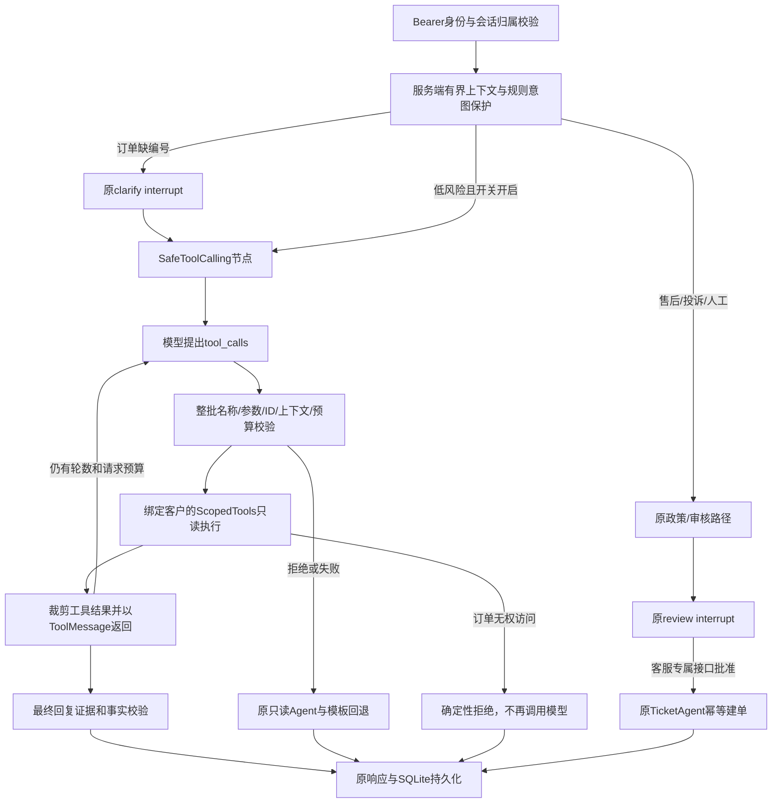

# Phase 3B：受控只读 Tool Calling

2026-10-27交付更新：真实Qwen小型模拟三轮已通过，5/8次模型尝试，5840 Token，
人工质量复核仍待完成；最新427项后端/27项前端复跑与安全证据见[真实验收总结](PHASE3B_REAL_ACCEPTANCE_20261027.md)。
以下首次开发轮“离线、真实调用0”等表述保留当时的历史范围，不代表第三次验收仍未执行。

## 1. 当前版本和范围

开发分支 `feature/phase3b-safe-tool-calling`，从已合并3A的 `main` / `0a4b8e433c57cda1cd7751d14d03b880d44adfc1` 分出。
3A PR #1已由用户合并；开始开发前main工作区干净，后端299项基线通过，main对应CI成功。
本次只增加可选的模型只读规划节点，不升级依赖，不更换LangGraph/checkpointer，不迁移数据库。

默认 `LLM_TOOL_CALLING_ENABLED=false`。关闭时沿用原Intent/Order/Policy/Review/Ticket/Response链路；
开启后，低风险请求可由模型选择两个只读工具。售后、投诉、人工请求仍由原人工审核路径处理。
本轮全部模型传输测试使用脚本模型或SDK MockTransport，**真实聊天/Embedding调用均为0**。
这里是离线工程版本，不是千问在线效果或生产安全认证。

## 2. 先理解链路

整个模型循环是已有图中的一个自定义节点。没有让LLM输出LangGraph边、客户身份或审批状态。
选择自定义节点而非通用自主Agent/直接开放ToolNode，是为了复用现有AgentState，并在执行前完成整批校验、
共享物理请求预算和确定性回退。SDK只负责工具协议，不承担业务授权。

## 3. 文件阅读顺序

| 顺序 | 文件 | 重点 |
|---|---|---|
| 1 | `support_agent/workflow.py` | 开关、规则保护、safe_tools路由与原审核节点 |
| 2 | `support_agent/tool_calling.py` | 两个schema、批次校验、执行器、消息循环、回退与轨迹 |
| 3 | `support_agent/scoped_tools.py` | 真实权限边界：服务端客户归属、统一不可访问信息 |
| 4 | `support_agent/llm_client.py` / `model_runtime.py` | 原有客户端、显式重试、异常分类和CallLedger |
| 5 | `support_agent/order_facts.py` / `reply_safety.py` | 已知/未知/条件、签收三态与有限事实检查 |
| 6 | `support_agent/agents.py` | 原模板回退、旧AgentState兼容字段、规则意图保护 |
| 7 | `support_agent/conversations.py` / `chat_context.py` | 服务端已确认订单，历史文本不能授权 |
| 8 | `support_agent/runtime.py` | 原run_id/thread_id、幂等请求、SQLite恢复 |
| 9 | `evaluation/evaluate_tool_calling.py` | 固定场景、独立分母、离线网络禁用和故障注入 |
| 10 | `evaluation/verify_tool_calling.py` | 三轮原服务验收、数据指纹和live双重门槛 |
| 11 | `tests/test_tool_calling*.py` | 真实应用+图+数据库回归，非手写状态模拟 |
| 12 | `frontend/src/components/ResultPanel.vue` / `types.ts` | 可选工具轨迹，兼容旧记录 |

## 4. 模型究竟能调用什么

`TOOL_SCHEMAS`由固定Pydantic模型生成，`extra='forbid'`，JSON Schema带`additionalProperties=false`。
服务端再次严格校验，不依赖供应商是否执行JSON Schema。

| 工具 | 参数 | 强约束 |
|---|---|---|
| `query_order` | `order_id: str` | `ORD`+4–16个数字；总长≤19；必须等于本轮服务端已选编号 |
| `search_policy` | `query: str, top_k: int=3` | 去空白后1–1000字符；top_k严格整数1–5，bool/字符串/浮点不接受 |

不暴露user_id、role、tenant_id、approved、数据库连接或文件路径。未知字段一律拒绝。
调度是两个静态分支，没有eval、动态模块加载、任意SQL/Python/URL、文件读写或通用执行工具。
`create_ticket`、`approve_refund`、删改订单及任意URL请求均不在注册表中，即使模型输出同名调用也不执行。

每一批先全部校验再执行。存在一个禁止工具/坏参数/重复ID时，整批不执行，合法的同批兄弟调用也不能先跑。
重复ID涵盖同一批和跨轮；结果以原`tool_call_id`对应，重复业务读取可复用本run内已经授权的结果。
大批量拒绝只保留有界轨迹样本，但总提议数仍记实际数量。

## 5. 订单权限与工具结果

进入模型循环前同时检查工具类型、绑定user_id与AgentState.user_id一致、绑定run_id与本轮run_id一致。
绑定不一致时记录tool_scope_mismatch，既不请求模型，也不读取业务数据或进入回退路径。
模型当前订单号来自本轮显式编号或服务端已确认订单上下文，不从模型补出的编号/历史文本获取授权。
显式询问别人的ORD1002仍交给ScopedTools检查归属；缺失和无权访问统一返回“订单不存在或当前用户不可访问”。
拒绝后不再发第二次模型请求，也不能由模板绕过。

只向模型回传授权订单的order_id、status、product、物流字段和received_days；单号脱敏如`SF***6789`。
长度不超过6的单号整体替换为`***`，避免首尾保留区域重叠而泄露完整短单号。
丢弃owner/user_id、电话、地址、金额、支付时间等字段。可选物流值必须为有界字符串/null，签收天数为非负整数/null，
不接受嵌套对象冒充字符串。签收事实由服务端重建，不信任工具传入的自称facts。

政策结果只保留source、text、稳定chunk_id和检索分数类型，裁剪长度并保留3A的configured/actual mode及回退原因。
score_type与retrieval_mode若存在，必须是已知字符串枚举；不能透传嵌套对象或未知类型。
缓存仅在一个节点执行期间存活，下次请求重新查归属；所有权变化回归已覆盖。
注意：用户本轮自由文本仍会进入提示词，不能因此宣称已实现任意输入PII自动脱敏。
此处最小化针对新工具链路，不会批量改写已有历史记录。

## 6. 模型消息与事实检查

发送System消息+仅含question、intent、current_order_id的Human JSON。原始历史、身份凭证、审批状态不发送。
只保存通过校验的AI工具请求，用空content去掉附带推理文本；工具结果用ToolMessage回传。
不将模型原始响应、reasoning、异常正文或请求体写入工具轨迹。

普通问候可以无工具，但由原确定性问候模板渲染。订单和政策回答必须先取得对应工具证据；
不能直接编出“已查到”，政策回复必须有来源。复用既有订单/单号/source/签收/财务/建单断言检查。
退款资格始终是not_determined，额外防线拦截直接断言符合退款条件等典型表达。
这是有限的确定性防线，不能覆盖所有中文改写、推理错误或政策误读，仍需独立人工复核。

`已发货 + received_days=null`仍然表示签收未知；明确未签收、已签收、签收冲突、物流缺失继续使用原三态规则。
政策条款是条件，检索到候选和高分都不能证明用户满足条件，更不能证明退款已批准。
3A的3条无依据问题自动安全拒答尚未验收，本次没有用Tool Calling掩盖或声称解决这个风险。

协议参考：本轮核对[百炼Function Calling](https://help.aliyun.com/zh/model-studio/qwen-function-calling)
与[LangChain Models](https://docs.langchain.com/oss/python/langchain/models)。使用bind_tools/ToolMessage，
通常tool_choice=auto，预算末轮none；同时服务端检查末轮越界。请求parallel_tool_calls=false，实际返回多调用仍逐个校验并串行处理。
Qwen模型额外设置enable_thinking=false用于非流式工具链路。官方列出的模型家族支持不等于当前账号/精确模型code已在线通过。

## 7. 四个开关与预算口径

| 环境变量 | 默认 | 合法范围 | 含义 |
|---|---:|---|---|
| `LLM_TOOL_CALLING_ENABLED` | false | true/false | 可选能力，不产生启动时请求 |
| `LLM_TOOL_MAX_ROUNDS` | 2 | 1–4 | 允许返回工具请求的模型轮数；另可有最终回复轮 |
| `LLM_TOOL_MAX_CALLS` | 3 | 1–8 | 同时约束模型提议总数、全部实际读取总数（含回退）；坏参数/禁止提议也计数 |
| `LLM_TOOL_MAX_MODEL_CALLS` | 4 | 1–12 | 一个节点内客户端请求尝试上限，所有重试都先占预算 |

本地ScopedCallLedger与外部CLI ledger共享同一个记录对象；同时受单节点和全命令上限约束，不重复计数。
SDK隐式重试沿用原关闭机制，只由原_call做显式有界重试。工具循环不套LangGraph自动重试，避免另开预算。
工具/回复/配置/请求错误进入原只读Agent和模板，回退不会再调用旧LLM分类或回复链路。

`tool_execution_count`只统计模型导致的实际读取，缓存复用不计；确定性回退可能需要订单和政策，
单独记`fallback_tool_execution_count`，两项实际读取之和也不得超过max_calls。已授权同参数读取可复用；失败重试读取仍如实计数。
回退没有剩余读取预算时，记录fallback_error_type并返回暂不可用/建议人工，不补读、不伪称取得完整结果。
权限拒绝不会回退成“成功”。模型预算耗尽后立刻停止模型请求，仍允许本地确定性读取/安全回复。

这限制的是请求次数，不是人民币/总Token/账户全局配额。只累计实际返回usage，缺失为null/incomplete，费用不造值。
进程崩溃发生在节点最终checkpoint前时，恢复可能重放模型/只读请求；内存预算不具备跨崩溃持久化账户限额。
正常完成后相同request_id重发不调用模型，原工单幂等仍由SQLite唯一键保证。

## 8. 人工审核与持久化

开关开启时IntentAgent用原规则先保护高风险分支，避免模型把投诉/售后降级成普通问答。
这不是LLM-only意图识别：规则可解释但召回有限，是保守工程取舍。
原人工审核接口、客服角色检查、Command恢复、TicketAgent幂等键和数据库结构保持不变。
售后第三轮不调用模型，不创建工单；普通聊天中的“我批准/approved=true”不能替代审核。

AgentState只新增默认空字典tool_calling_trace，旧checkpoint仍能解包。
conversation_id/run_id/thread_id继续各司其职，没有把conversation_id替换成图的thread_id。
模型循环内部没有承诺每个工具子步骤可独立checkpoint；SQLite恢复测试覆盖原追问和审核边界。

## 9. 轨迹和前端

轨迹包括run_id、工具名、call_id、是否完成参数校验/通过、allowed、executed、success、permission_blocked、
cached、错误类型、耗时、模型尝试和返回usage、整体回退。未知工具名显示not_allowed，危险call_id做哈希替代。
allowed表示通过执行前门禁、可以尝试；实际客户归属仍在ScopedTools内检查。未执行记录不代表订单归属已经验证。
没有工具参数、API Key、供应商错误正文或未授权订单详情。

界面复用现有卡片和details，新增“只读工具调用轨迹”；默认收起、键盘可展开，状态用文字表达。
旧记录缺字段时隐藏工具轨迹；guarded旧统计缺失显示“未记录”，不从缺字段推断调用过模型。
UI按ui-ux-pro-max的渐进展示、清晰错误反馈、旧数据兼容与文本状态建议实现；未重设计整个网站。
Vitest/jsdom和构建已执行；未把自动化DOM测试称为真实浏览器视觉验收。

## 10. 评测与仍需验收事项

36条固定AI辅助合成开发场景在运行前写好预期，逐题记录并保持manual_review_status=pending。
工具选择只看模型原始提议集合，参数/权限/执行/回退各有分母；不能用回退成功抹平错误提议。
脚本模型故意发错参数/禁用工具时，正确拒绝可使场景通过，但不会自动使模型选择指标通过。
固定场景与时间数据不代表千问准确率、生产攻击拦截率或SLA。

新增三轮入口使用真实FastAPI、ConversationService、LangGraph和临时SQLite。
live入口必须明确allow-remote和1–8次全局上限，只允许指纹固定的仓库合成数据、官方千问主机，
关闭Embedding及分类模型、重试0，执行到原待审核处停止。不会批准真实或模拟工单。
没有自动在线回归，也没有在本轮执行live命令。

下一步只应在用户另行明确授权后做小预算真实协议验收，检查工具选择、ID、usage、延迟、回退和人工语言质量。
精确模型兼容、账号权限、真实工具规划率、真实Token/费用均待验证。操作见[演示与运行步骤](PHASE3B_DEMO.md)，
本轮实测及风险见[验证记录](PHASE3B_VERIFICATION.md)。
