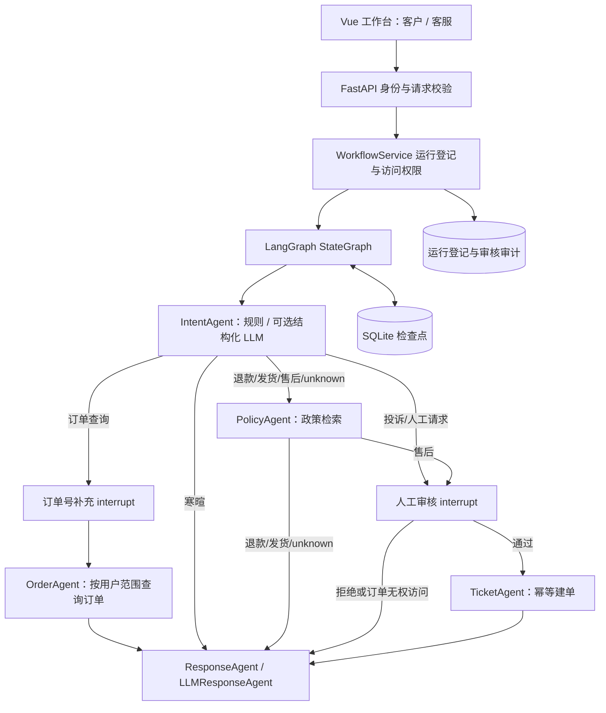

# 企业客服多 Agent 系统 v0.2：升级说明与学习路线

这一版将项目升级为可持久化、可审核、可恢复的客服工作流。业务订单仍为测试数据；上线能力和上线业务是两件不同的事。

## 1. 已落地的架构



工作流节点只处理自己的职责。API 负责身份，ScopedTools 负责订单归属，数据库负责工单去重。模型不能替代这些校验。

## 2. 从页面到代码的学习顺序

1. 先运行订单查询 ORD1001：读 `frontend/src/App.vue` 的 runAgent，再读 `frontend/src/api.ts` 和 `support_agent/app.py` 的 /agent/run。
2. 读 `auth.py`：凭证映射到服务器身份；customer 无法通过修改 user_id 冒充其他客户。
3. 读 `runtime.py` 的 start：request_id 用于重复请求去重；服务器生成 run_id；同一 request_id 搭配不同输入返回 409。
4. 读 `workflow.py`：StateGraph 通过条件边选择节点，SqliteSaver 保存节点执行后的状态。订单查询经过 intent → clarify → order → response。
5. 输入“我的订单到哪了”：clarify 节点 interrupt，接口返回 awaiting_input。提交 ORD1001 后，通过 Command(resume=...) 从同一 thread_id 恢复。
6. 输入“我要投诉”：review 节点 interrupt，接口返回 awaiting_review。这个时候数据库没有新工单。
7. 切换客服身份，在历史记录打开该请求，审核通过后执行 ticket 节点；拒绝则绕过 ticket，生成明确的拒绝回复。
8. 读 `scoped_tools.py` 和 `business_db.py`：检查归属、参数化 SQL、事务以及工单 idempotency_key 唯一索引。
9. 读 `agents.py` 和 `llm_client.py`：模板是兜底回复；可选模型分类输出由 Pydantic 校验。模型不负责批准工单，不接收用户提供的工具名或身份。
10. 读 `tests/test_workflow.py`：逐项对应真实故障，特别是“数据库写入成功，但节点尚未保存检查点时出错”的恢复测试。

## 3. API 契约

业务请求均要求 `Authorization: Bearer ...`，健康检查 `/` 不需要。

| 操作 | 接口 | 权限 |
|---|---|---|
| 当前身份 | GET /me | 客户 / 客服 |
| 发起工作流 | POST /agent/run | 客户只能为自己发起；客服可指定服务对象 |
| 运行历史 | GET /agent/runs | 客户仅自己的记录；客服全部 |
| 待审核队列 | GET /agent/reviews?limit=50&offset=0 | 仅客服，支持分页 |
| 单次运行 | GET /agent/runs/{run_id} | 同上 |
| 补充订单号 | POST /agent/runs/{run_id}/resume | 可访问此请求的身份 |
| 审核 | POST /agent/runs/{run_id}/review | 仅客服 |
| 故障恢复 | POST /agent/runs/{run_id}/retry | 可访问此请求的身份 |
| 审计记录 | GET /agent/runs/{run_id}/audit | 仅客服 |

`/agent/run` 示例：

```json
{"user_input":"我的订单 ORD1001 到哪了？","user_id":"U1001","request_id":"a5f6cf00-2aa7-4450-bcef-f234cd5ec587"}
```

响应 status 为 completed、awaiting_input、awaiting_review、running 或 failed。状态必须来自后端；前端禁用按钮只是交互提示。

## 4. 为什么持久化仍然需要幂等

检查点不能保证外部业务写入只执行一次。假设 ticket 节点已经插入工单，随后进程崩溃，而检查点尚未完成保存。恢复后 ticket 节点会重新运行。

本项目用 `run_id:ticket` 作为业务幂等键，在 SQLite 事务中查询并创建工单，并通过唯一索引保证去重。相同键、相同业务参数返回已有工单；相同键、不同业务参数拒绝执行。

准确说法是：重放可能重复执行节点，但当前工单数据库里只产生一条相同操作的记录。未来接外部工单 API 时，必须让外部 API 也支持幂等键；仅在本服务内记一次日志并不够。

## 5. 模型与 RAG 的边界

LLM_INTENT_ENABLED=true 且配置模型时，分类输出由 IntentDecision 白名单约束；强烈投诉和显式人工请求保持保守路由。模型故障降级到规则。模型分类没有标定置信度，因此页面展示识别依据。

回复生成设置超时和一次 SDK 重试，失败保留模板。审核拒绝、权限拒绝和已确定的售后建单结果使用确定性回复。政策模板直接呈现召回片段，不再把硬编码政策当成检索结论。

RAG 当前仍为字符级 TF-IDF。它是可替换的检索基线，不应描述为 Embedding、混合检索或重排序。模型提示词约束也不能等同于已解决所有幻觉问题。

## 6. 数据与迁移

- business.db：用户、订单、工单。启动时仅新增 tickets.idempotency_key 列和唯一索引；不清空已有数据。
- workflow_checkpoints.db：LangGraph 检查点。
- workflow_runs.db：运行登记、最终状态缓存、审核事件。
- 原有 agent_logs.db 保留，旧运行记录不自动导入新流程。旧日志没有检查点，无法转换成可恢复的工作流。
- SUPPORT_DATA_DIR 可指定持久化目录；政策和样例订单仍从项目 data 目录读取。

## 7. 部署范围与后续升级

当前实现支持一个 API worker，并通过进程级锁串行执行工作流。它适合低并发试点和验证业务集成。不要用 --workers 4 宣称支持分布式恢复。

要多实例部署，下一步需一起实现 PostgreSQL 检查点、分布式运行锁或任务队列、后台任务超时与恢复、独立运行并发限制。静态 Bearer 凭证需要替换成企业 OIDC/SSO。除此之外，还需要真实工单系统适配、授权数据接入、业务评测和运维指标。

Dockerfile 和 CI 配置已经提供。Docker 构建和 GitHub Actions 运行需要在相应环境实际验证；本地测试通过不等同于部署验收通过。

## 8. 面试表述

“我将客服系统的编排升级为 LangGraph 状态图，通过持久化检查点实现订单信息补充、人工审核和故障恢复。工具层校验订单归属，工单使用数据库唯一幂等键防止恢复时重复建单，并记录审核身份和执行节点。LLM 分类采用结构化输出校验，回复保留超时降级。当前是单实例试点架构，下一阶段针对多实例引入 PostgreSQL 和分布式任务调度。”

不要写已经接入真实企业、已有生产用户、支持高并发或业务指标提升，除非确实完成并测量过。
